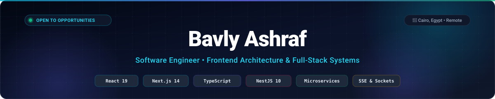

<div align="center">

  <p align="center">
    <a href="https://bavly001.github.io/portfolio/">
      
    </a>
  </p>
  
  <a href="https://bavly001.github.io/portfolio/">
    
  </a>

  <p>
    <a href="https://bavly001.github.io/portfolio/"></a>
    <a href="https://www.linkedin.com/in/bavlyashraf/"></a>
    <a href="mailto:a_bavly@yahoo.com"></a>
    <a href="https://wa.me/201271931937"></a>
    <a href="https://bavly001.github.io/portfolio/Bavly-Ashraf-Resume.pdf"></a>
  </p>

</div>

---

## 👋 About Me

I'm a **Software Engineer** specializing in designing and shipping high-performance, responsive web applications and distributed full-stack systems. My core expertise centers on **React 19**, **Next.js 14 (App Router)**, **TypeScript**, **NestJS 10**, and **TiDB Cloud Serverless MySQL**.

- 🎓 **Education:** B.Sc. in Computer Science, Future Academy — **GPA 3.75 / 4.00** *(Excellent with Honors)*, Graduation Project Grade **A+**
- 💼 **Production Experience:** Built dental clinic workflow automation & FEFO inventory tracking at **Dexi**, engineered high-traffic esports tournament brackets and WebSockets at **PREEZY / GamerG**, and architected the **Kitcheniano** multi-tenant restaurant microservices ecosystem
- ⚡ **Core Focus:** Sub-second UI performance, resilient client state (Redux Toolkit, Zustand, TanStack Query), Server-Sent Events (SSE), and multi-tenant security contracts
- 📍 **Location:** Cairo, Egypt • Available for full-time, hybrid, or remote software engineering roles
- 🗣️ **Languages:** Arabic (Native), English (Professional Working Proficiency)

---

## 🧱 Architecture at a Glance

```text
┌────────────────────────────────────────────────────────────────────────────────────────┐
│                          FULL-STACK & CLIENT SYSTEM TOPOLOGY                           │
├────────────────────┬───────────────────────────────────────────────────────────────────┤
│ CLIENT / UI        │ Next.js 14 (App Router) • React 19 • React Native • Tailwind CSS  │
│ CLIENT STATE       │ Redux Toolkit • Zustand • TanStack Query • Optimistic UI Caching  │
│ REAL-TIME LAYER    │ Server-Sent Events (SSE) • WebSockets • Audio Alert Dispatchers   │
│ APPLICATION APIS   │ NestJS 10 • Express 4 • Node.js • REST APIs • RBAC & Route Guards │
│ SECURITY & TENANCY │ Multi-Tenant Partitioning (organizationId) • JWT • bcrypt • Zod   │
│ PERSISTENCE        │ TiDB Cloud Serverless (MySQL 8) • TypeORM • SSL/TLS 1.2 Pools     │
│ OBJECT STORAGE     │ Backblaze B2 S3 (AWS SDK v3) • Pre-signed CDN Delivery            │
│ DEPLOYMENT         │ Vercel Edge • Render • Multi-Stage Docker • GitHub Actions CI/CD  │
└────────────────────┴───────────────────────────────────────────────────────────────────┘
```

---

## ⚡ What I Do Best

<table>
  <tr>
    <td width="33%" valign="top">
      <h4 align="center">🏛️ Frontend Architecture &amp; Systems</h4>
      <p align="center">
        Modular component systems with <b>React 19</b> and <b>Next.js 14 App Router</b>, cross-platform UI synchronization with <b>React Native</b>, memoized re-render optimization, and sub-second load times.
      </p>
    </td>
    <td width="33%" valign="top">
      <h4 align="center">🔄 Real-Time &amp; Microservices</h4>
      <p align="center">
        Event-driven architectures using <b>Server-Sent Events (SSE)</b> and <b>WebSockets</b>, decoupled microservices, background job bridges, and optimistic client cache synchronization.
      </p>
    </td>
    <td width="33%" valign="top">
      <h4 align="center">🛡️ Multi-Tenancy &amp; Data Integrity</h4>
      <p align="center">
        Strict relational tenant partitioning with indexed <code>organizationId</code> keys, <b>FEFO</b> inventory batch algorithms, <b>JWT / RBAC</b> route guards, and zero-data-loss validation with <b>Zod</b>.
      </p>
    </td>
  </tr>
</table>

---

## 🚀 Featured Engineering Projects

<table>
  <tr>
    <td width="50%" valign="top">
      <h3>🍳 Kitcheniano — Operations Hub</h3>
      <p><b>Multi-tenant kitchen operations &amp; FEFO stock system</b></p>
      <p>
        <a href="https://kitcheniano-dashboard-fe.vercel.app/"></a>
        
      </p>
      <ul>
        <li>Strict multi-tenant architecture with <b>NestJS 10</b>, TypeORM, and <b>TiDB Cloud Serverless MySQL</b>.</li>
        <li>Real-time <b>Server-Sent Events (SSE)</b> kitchen dispatch with synthesized audio chimes for incoming orders.</li>
        <li>Automated <b>First-Expired, First-Out (FEFO)</b> non-negative batch inventory deduction and P&amp;L financial ledgers.</li>
        <li>Cloud dish image hosting via <b>Backblaze B2 S3</b> with AWS SDK v3 pre-signed upload URLs.</li>
      </ul>
      <p><code>Next.js 14</code> <code>NestJS 10</code> <code>TiDB Cloud MySQL</code> <code>TypeORM</code> <code>SSE</code> <code>Backblaze B2</code> <code>Docker</code></p>
    </td>
    <td width="50%" valign="top">
      <h3>🍽️ Kitcheniano — Customer Storefront</h3>
      <p><b>Customer ordering experience &amp; live order tracker</b></p>
      <p>
        <a href="https://kitcheniano-client-fe.vercel.app/"></a>
        <a href="https://github.com/Bavly001/kitcheniano-client-FE"></a>
      </p>
      <ul>
        <li>Decoupled customer web application built with <b>Next.js 14</b> and an independent <b>Express 4 microservice</b>.</li>
        <li>Real-time visual order timeline tracker driven by <b>Server-Sent Events (SSE)</b> with polling resilience.</li>
        <li>Dynamic cart drawer, address validation, phone formatting, and customer authentication (JWT &amp; bcrypt).</li>
        <li>Seamlessly synchronized with the kitchen operations backend over shared TiDB Cloud MySQL.</li>
      </ul>
      <p><code>Next.js 14</code> <code>Express.js</code> <code>Zustand</code> <code>SSE</code> <code>MySQL</code> <code>Tailwind CSS</code> <code>Vercel</code></p>
    </td>
  </tr>
  <tr>
    <td width="50%" valign="top">
      <h3>🚀 Doit — Task &amp; Productivity Platform</h3>
      <p><b>Full-stack task management with optimistic caching</b></p>
      <p>
        <a href="https://todo-list-app.bavly200138.workers.dev/"></a>
        <a href="https://github.com/Bavly001/todo-list-app"></a>
      </p>
      <ul>
        <li>Decoupled SPA on <b>React 18</b> and <b>Express 4 REST API</b> on <b>TiDB Cloud Serverless MySQL</b> with TLS 1.2.</li>
        <li>Enterprise authentication with HMAC SHA-256 JWT tokens and 10-round bcrypt password hashing.</li>
        <li>Zero-latency state synchronization with <b>Redux Toolkit</b> and <b>TanStack Query</b> optimistic updates.</li>
        <li>Deployed across Cloudflare Workers, Render, and TiDB Cloud with Docker multi-stage builds.</li>
      </ul>
      <p><code>React 18</code> <code>Express.js</code> <code>TiDB Cloud MySQL</code> <code>Redux Toolkit</code> <code>TanStack Query</code> <code>Docker</code></p>
    </td>
    <td width="50%" valign="top">
      <h3>🎨 Facetcher — AI Sketch-to-Realism</h3>
      <p><b>Interactive neural canvas &amp; photorealistic face synthesis</b></p>
      <p>
        <a href="https://github.com/Bavly001"></a>
        
      </p>
      <ul>
        <li>Graduation project awarded <b>Grade A+ (GPA 3.75 with Honors)</b>; served as Frontend Engineering Lead.</li>
        <li>Multi-layer HTML5 interactive canvas with stroke smoothing, history rollback, and dual-panel rendering.</li>
        <li>Real-time REST communication with PyTorch deep learning inference APIs synthesizing realistic facial portraits.</li>
        <li>Optimized binary image payload transfer pipelines and responsive parameter controls.</li>
      </ul>
      <p><code>React.js</code> <code>TypeScript</code> <code>HTML5 Canvas</code> <code>Deep Learning APIs</code> <code>Tailwind CSS</code></p>
    </td>
  </tr>
  <tr>
    <td width="50%" valign="top">
      <h3>🦷 Dexi Dental Assistant &amp; Inventory Suite</h3>
      <p><b>Clinical workflow automation &amp; medical supply monitoring</b></p>
      <p>
        
        
      </p>
      <ul>
        <li>Architected core dental workflow automation, doctor-staff scheduling, and task allocation interfaces.</li>
        <li>Built an end-to-end medical supply tracking system featuring live counts and <b>FEFO batch stock monitoring</b>.</li>
        <li>Automated low-supply alert thresholds preventing procedural delays across dental clinic operations.</li>
        <li>Centralized Redux Toolkit state with memoized re-render optimization and Zod schema enforcement.</li>
      </ul>
      <p><code>React.js</code> <code>TypeScript</code> <code>Redux Toolkit</code> <code>React Hook Form</code> <code>Zod</code> <code>Tailwind CSS</code></p>
    </td>
    <td width="50%" valign="top">
      <h3>🏆 PREEZY Esports &amp; Tournament Live Hub</h3>
      <p><b>High-traffic tournament brackets &amp; WebSocket live score companion</b></p>
      <p>
        
        
      </p>
      <ul>
        <li>Engineered responsive <b>Next.js</b> web applications and spearheaded <b>React Native</b> mobile extensions (iOS &amp; Android).</li>
        <li>Sub-second load times and zero-lag live score transitions powered by real-time <b>WebSocket</b> event listeners.</li>
        <li>Unified design system and shared component design tokens across web and mobile platforms.</li>
        <li>Intelligent client-side caching and API request interceptors for high-concurrency tournament traffic.</li>
      </ul>
      <p><code>Next.js</code> <code>TypeScript</code> <code>React Native</code> <code>WebSockets</code> <code>REST APIs</code> <code>Tailwind CSS</code></p>
    </td>
  </tr>
</table>

---

## 🛠️ Technical Arsenal

<div align="center">

| Category | Technologies |
| :--- | :--- |
| **Frontend &amp; UI** |         |
| **State &amp; Real-Time** |    -06B6D4?style=flat-square)  |
| **Backend &amp; Microservices** |      |
| **Databases &amp; Cloud** |   -E02428?style=flat-square)    |
| **Architecture, Security &amp; DevOps** |  -000000?style=flat-square&logo=jsonwebtokens&logoColor=white)      |

</div>

---

## 🏢 Professional Experience

### Frontend Web Developer · Dexi
*Jul 2024 – Present · Cairo, Egypt (Remote)*

- **Automated Clinical Workflows:** Architected core dental practice automation using modular React components and custom hooks, including doctor-staff scheduling and automated task allocation, eliminating manual paper logs.
- **Real-Time Stock & Inventory:** Built an end-to-end medical supply tracking interface featuring live counts, **FEFO batch monitoring**, and automated low-supply alerts to prevent procedural delays.
- **State & Error Handling:** Centralized state with Redux Toolkit and enforced frontend token/session management (JWT, RBAC), client-side schema validation (React Hook Form/Zod), and React Error Boundaries.

### Frontend &amp; React Native Developer · PREEZY (GamerG)
*Jun 2025 – Jul 2026 · Amman, Jordan (Remote)*

- **High-Traffic Web Applications:** Engineered responsive web apps with Next.js and TypeScript, building reusable UI components for tournament brackets and live analytics delivering sub-second load times.
- **Cross-Platform Mobile Expansion:** Spearheaded frontend expansion into **React Native** (iOS &amp; Android), establishing shared design systems and state patterns unifying web and mobile UX.
- **Real-Time Microservices:** Integrated frontend clients with backend microservices via REST APIs and WebSockets, utilizing client-side caching and request interceptors for smooth live events.

### Frontend Web Developer · Exabyte LLC
*Mar 2024 – Jul 2024 · Cairo, Egypt (On-site)*

- **Healthcare Portals:** Developed operational React/TypeScript web portals for health insurance providers, building complex multi-step forms with client-side validation for claims processing.
- **E-Commerce &amp; Analytics:** Built responsive storefronts and interactive sales monitoring dashboards giving management live visibility into order lifecycles and revenue trends.
- **Agile Scrum Delivery:** Containerized frontend environments using Docker, followed Git branching workflows, and contributed to CI/CD deployment verification.

---

## 📚 Education &amp; Academic Honors

**🎓 B.Sc. in Computer Science** · Future Academy, Higher Future Institute for Specialized Technological Studies · *2019 – 2023*  
- **Cumulative GPA:** **3.75 / 4.00** *(Excellent with Honors)*  
- **Graduation Project:** Facetcher — AI Sketch-to-Realism Neural Platform · **Grade: A+**  
- **Core Coursework:** Data Structures &amp; Algorithms, Object-Oriented Programming (OOP), Database Systems &amp; SQL, Software Engineering &amp; Architecture, Operating Systems, Web Technologies.

---

## 📬 Let's Connect &amp; Collaborate

Looking for a product-minded Software Engineer to build scalable frontend architectures, responsive web apps, or full-stack microservices? Let's connect!

<div align="center">

<a href="https://bavly001.github.io/portfolio/"></a>
<a href="https://www.linkedin.com/in/bavlyashraf/"></a>
<a href="mailto:a_bavly@yahoo.com"></a>
<a href="https://wa.me/201271931937"></a>

</div>
